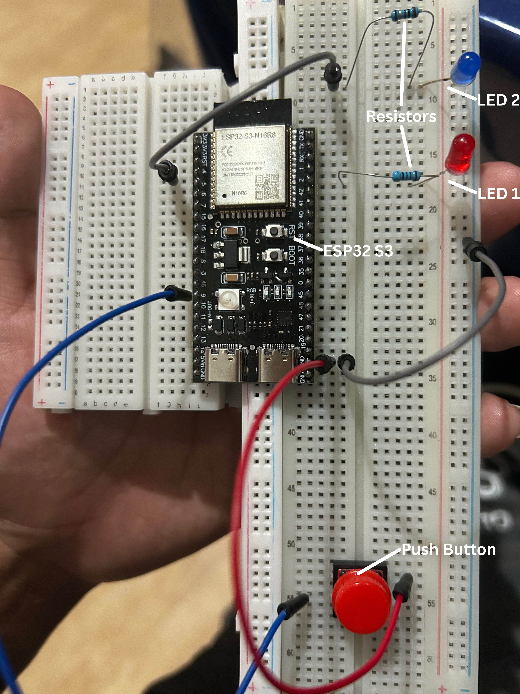

# Button and Dual LED Laboratory Activity

## Circuit Photo

## Pressed / Released Observation Table
| Button State | GPIO 9 Reading | Primary LED (`ledPin1` on GPIO 2) | Second LED (`ledPin2` on GPIO 4) | Serial Monitor Output |
| :--- | :--- | :--- | :--- | :--- |
| **Released** | `HIGH` | OFF (`LOW`) | ON (`HIGH`) | `Button Released -> LED1: OFF, LED2: ON` |
| **Pressed** | `LOW` | ON (`HIGH`) | OFF (`LOW`) | `Button Pressed -> LED1: ON, LED2: OFF` |
